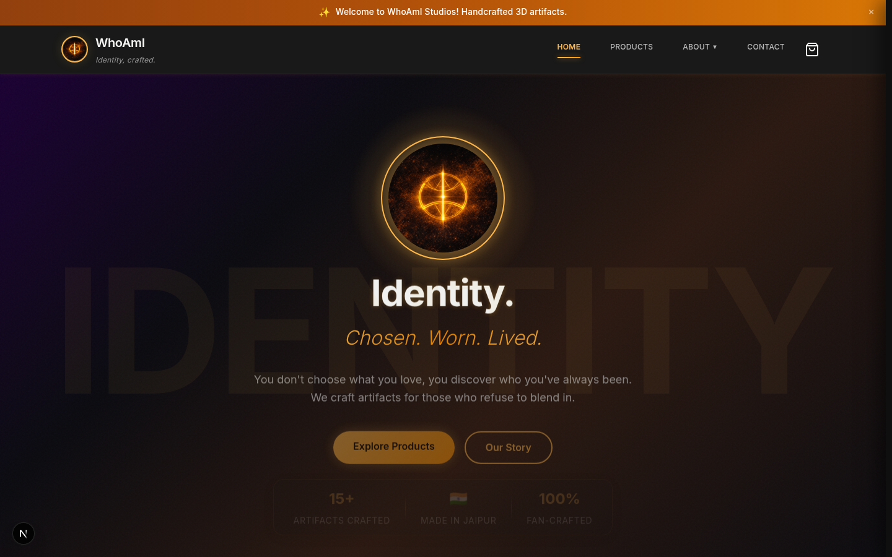
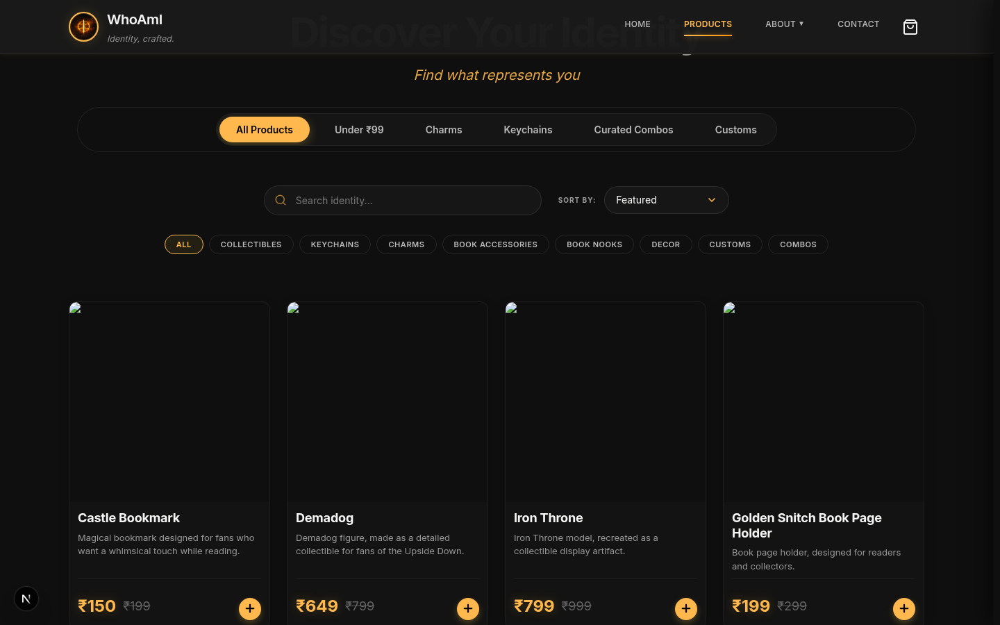
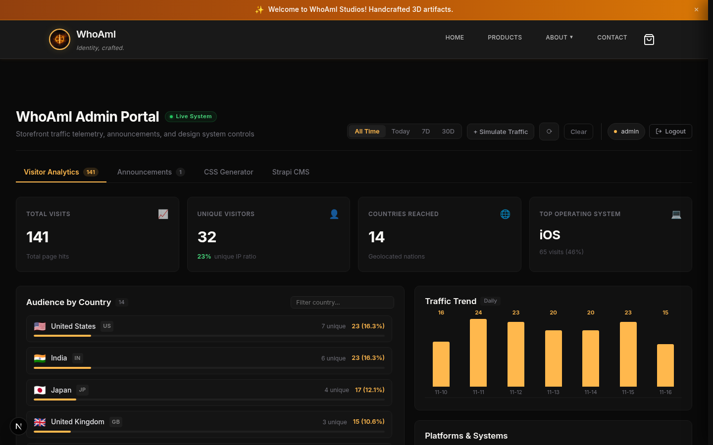
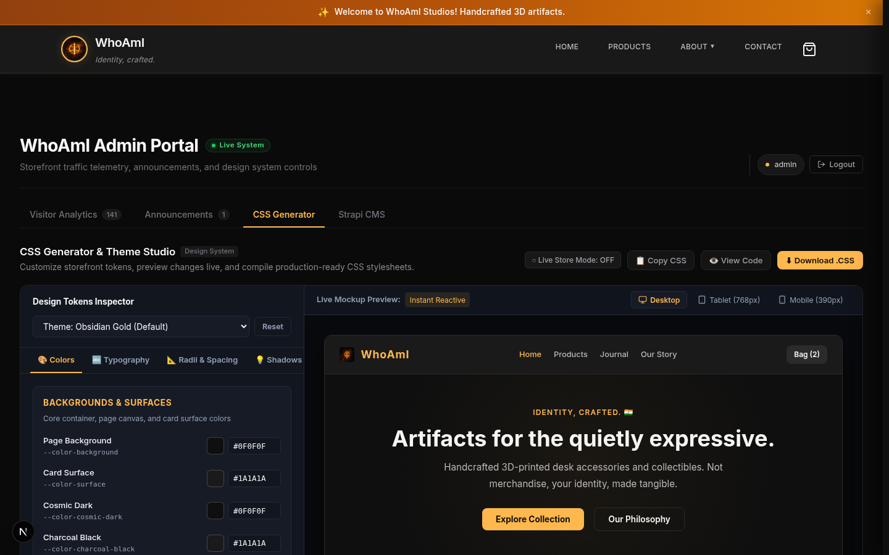

# WhoAmI Studios — Full-Stack E-Commerce Platform

A production-grade, full-stack e-commerce monorepo built for **WhoAmI Studios** — handcrafted 3D-printed identity artifacts, fandom bookmarks, keychains, desk decor, and collectibles designed and crafted in Jaipur, India.

---

## 📸 Platform Screenshots

### 1. Home Page
*Immersive cosmic luxury landing experience with 3D logo depth tilt, fluid dynamics WebGL background, brand narrative, and featured collections.*



---

### 2. Products Catalogue Page
*Dynamic product catalogue with instant category filtering, real-time search, responsive product cards, stock indicators, and quick-view capabilities.*



---

### 3. User Analytics — Admin Dashboard
*Real-time visitor telemetry, geocoded IP country breakdown with flag indicators, top visited pages, device and operating system analytics, traffic timeline bar charts, and recent visit logs.*

> **Admin Dashboard Login Credentials:**
> - **Username**: `admin`
> - **Password**: `admin`



---

### 4. CSS Generator & Theme Studio
*Interactive design system suite: customize storefront tokens (colors, gradients, typography, glow effects, borders), preview live across UI components, toggle real-time site overrides (`Live Store Mode`), and export compiled production CSS.*



---

## 🏛️ System Architecture

```
                                  ┌─────────────────────────────┐
                                  │      Client Browsers        │
                                  └──────────────┬──────────────┘
                                                 │
                                                 ▼
                                  ┌─────────────────────────────┐
                                  │    apps/web (Next.js 16)    │
                                  │   React 19 + Tailwind CSS   │
                                  │    Port: 3000 (Storefront)  │
                                  └──────┬───────────────┬──────┘
                                         │               │
                     REST / Analytics API│               │CMS Content / Media
                                         ▼               ▼
┌───────────────────────────────┐                 ┌───────────────────────────────┐
│     services/api (Express 5)  │                 │      apps/cms (Strapi v5)     │
│   Port: 5001 (Microservice)   │                 │      Port: 1337 (Headless)    │
├───────────────────────────────┤                 ├───────────────────────────────┤
│ • PostgreSQL Connection Pool  │                 │ • Product Catalogue Schemas   │
│ • Redis Caching & Rate Limits │                 │ • Dynamic Store Announcements │
│ • GeoIP Telemetry (ipwho.is)  │                 │ • Editorial Articles & Blog   │
│ • BullMQ Job Queue Service    │                 │ • Media Asset Library         │
│ • Swagger OpenAPI (/api-docs) │                 └───────────────┬───────────────┘
└──────────────┬────────────────┘                                 │
               │                                                  │
               ▼                                                  ▼
┌─────────────────────────────────────────────────────────────────────────────────┐
│                           PostgreSQL Database (store_db)                        │
└─────────────────────────────────────────────────────────────────────────────────┘
```

---

## 📦 Project Structure

```
PL-LA9-Ecom-Website/
├── apps/
│   ├── web/                     # Frontend Next.js 16 application (port 3000)
│   │   ├── app/                 # App Router (home, products, cart, blog, admin, etc.)
│   │   │   ├── admin/           # Admin Portal (User Analytics, Announcements, CSS Generator)
│   │   │   ├── products/        # Catalogue & Product Detail views
│   │   │   └── (home)/          # Immersive landing page with interactive hero
│   │   ├── components/          # Reusable UI components (Navbar, CartDrawer, FluidSimulation)
│   │   ├── context/             # React Contexts (AdminAuthContext, CartContext, ThemeContext)
│   │   ├── public/              # Static assets, product images, and brand favicon
│   │   └── styles/              # Global styles, variables, and design tokens
│   │
│   └── cms/                     # Strapi v5 Headless CMS (port 1337)
│       ├── config/              # Database, plugins, and server configurations
│       ├── database/            # Strapi schema and migration data
│       └── src/api/             # Content-type schemas (products, announcements, articles)
│
├── services/
│   └── api/                     # Express 5 REST API & Backend Service (port 5001)
│       ├── db/                  # PostgreSQL pool connection
│       ├── routes/              # Modular API routes (products, analytics, announcements, orders)
│       ├── services/            # Core logic (analyticsService, cachingService, productService)
│       └── scripts/             # Interactive CLI inventory manager
│
├── database/                    # Legacy and backup databases
├── scripts/                     # Operational utilities (traffic simulator, schema migrator)
├── screenshots/                 # High-resolution platform documentation screenshots
└── package.json                 # Monorepo root with npm workspaces & concurrent scripts
```

---

## ✨ Key Features

- **Storefront & Design System**:
  - Cosmic luxury aesthetic powered by Tailwind CSS and custom design tokens.
  - Interactive WebGL fluid dynamics canvas (`FluidSimulation`) that responds to mouse and touch.
  - Dynamic cart drawer with persistent item storage and instant WhatsApp checkout integration.
  - Brand favicon (`whoami_logo.png`) seamlessly integrated across browser tabs and devices.

- **Real-Time Visitor Telemetry & Geolocation**:
  - Automatic IP extraction, geocoding (`geoip-lite` with `ipwho.is` fallback), country flag resolution, and user-agent device/OS parsing.
  - Aggregated analytics reporting: unique visitors, top visited pages, device breakdowns, and timeline charts.
  - Global traffic simulation utility (`scripts/simulate_traffic.js`) for load and telemetry testing.

- **CSS Generator & Theme Studio**:
  - In-browser design token customizer for typography, colors, glows, and card borders.
  - **Live Store Mode**: toggle real-time CSS token injection across the actual storefront without rebuilding.
  - Built-in theme presets (*Dark Magic*, *Royal Alchemy*, *Cyber Twilight*, *Ethereal Light*) with instant clipboard export and `.css` stylesheet downloads.

- **Strapi Headless CMS**:
  - Decoupled content management for products, editorial stories, and active promotional banners.
  - Live announcement ticker synced directly to the storefront banner.

- **High-Performance Infrastructure**:
  - Redis caching layer for sub-millisecond response times.
  - Redis-backed distributed rate limiting for API endpoint protection.
  - Interactive OpenAPI / Swagger documentation accessible at `/api-docs`.

---

## 🚀 API Reference

Interactive Swagger documentation is available at `http://localhost:5001/api-docs`.

### Products API
| Method | Endpoint | Description |
|---|---|---|
| `GET` | `/api/products` | Retrieve catalog with optional pagination (`limit`, `offset`) |
| `GET` | `/api/products/:id` | Fetch single product by ID or slug |
| `GET` | `/api/products/combos` | Retrieve curated bundle offerings |

### Analytics API
| Method | Endpoint | Description |
|---|---|---|
| `POST` | `/api/v1/analytics/track` | Record visitor page view, IP, referrer, and user-agent |
| `GET` | `/api/v1/analytics/stats?timeRange=all` | Fetch telemetry statistics, country distribution, and charts |
| `POST` | `/api/v1/analytics/simulate` | Trigger synthetic visitor traffic across global IPs |
| `DELETE` | `/api/v1/analytics/reset` | Clear analytics telemetry logs (Admin protected) |

### Announcements API
| Method | Endpoint | Description |
|---|---|---|
| `GET` | `/api/v1/announcements` | Retrieve active store announcement banners |
| `POST` | `/api/v1/announcements` | Publish a new announcement banner |
| `PUT` | `/api/v1/announcements/:id` | Update banner text, type, or active state |

---

## 🛠️ Run Locally

### Prerequisites
- **Node.js** 20+ and **npm**
- **PostgreSQL** database running locally or via cloud
- **Redis** server (optional, in-memory fallback enabled automatically)

### 1. Installation
Clone the repository and install all dependencies across monorepo workspaces:
```bash
git clone https://github.com/IshitaAgarwal05/PL-LA9-Ecom-Website.git
cd PL-LA9-Ecom-Website
npm run install:all
```

### 2. Start the Development Stack
Run all applications concurrently (`web`, `api`, and `cms`):
```bash
npm run dev
```

Alternatively, start services individually:
```bash
npm run dev:web    # Next.js Storefront on http://localhost:3000
npm run dev:api    # Express REST API on http://localhost:5001
npm run dev:cms    # Strapi CMS on http://localhost:1337
```

### 3. Accessing the Platform
- **Storefront**: [http://localhost:3000](http://localhost:3000)
- **Catalogue**: [http://localhost:3000/products](http://localhost:3000/products)
- **Admin Portal**: [http://localhost:3000/admin](http://localhost:3000/admin)
  - *Default Credentials*: Username: `admin` / Password: `admin`
- **Swagger API Docs**: [http://localhost:5001/api-docs](http://localhost:5001/api-docs)
- **Strapi CMS Panel**: [http://localhost:1337/admin](http://localhost:1337/admin)

### 4. Useful Utilities
- **Simulate Global Traffic**:
  ```bash
  node scripts/simulate_traffic.js 50
  ```
- **CLI Inventory Manager**:
  ```bash
  npm run manage -w services/api
  ```

---

## 📜 License & Credits
Crafted in Jaipur, India · © 2026 WhoAmI Studios.  
Academic lab project by **Ishita Agarwal** (M.Tech CSIS, MNIT Jaipur).
