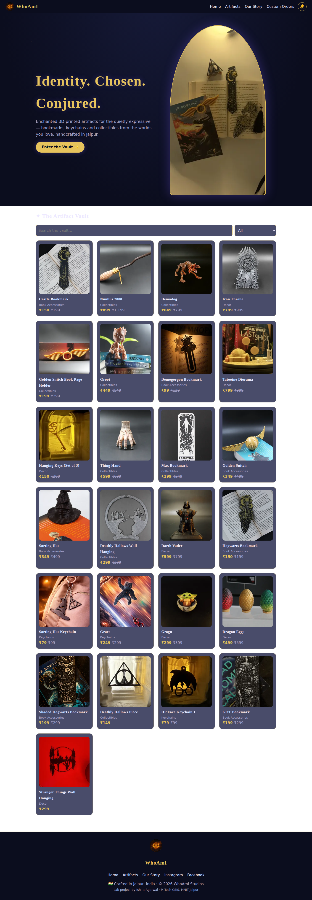
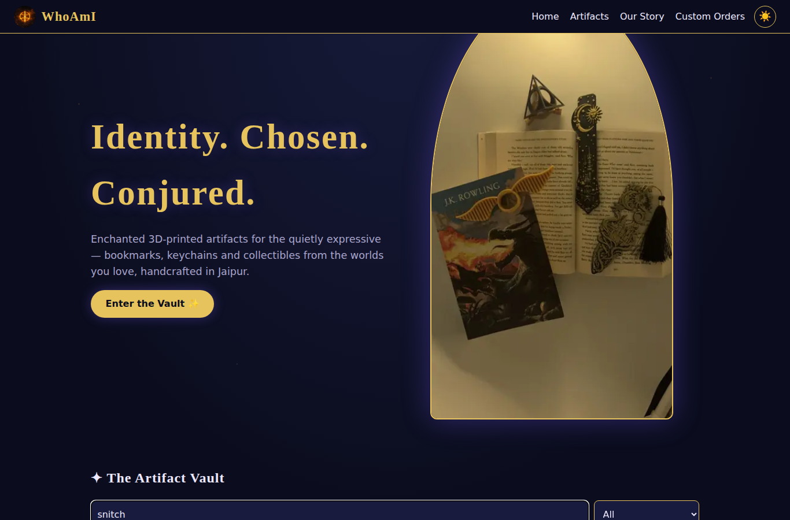
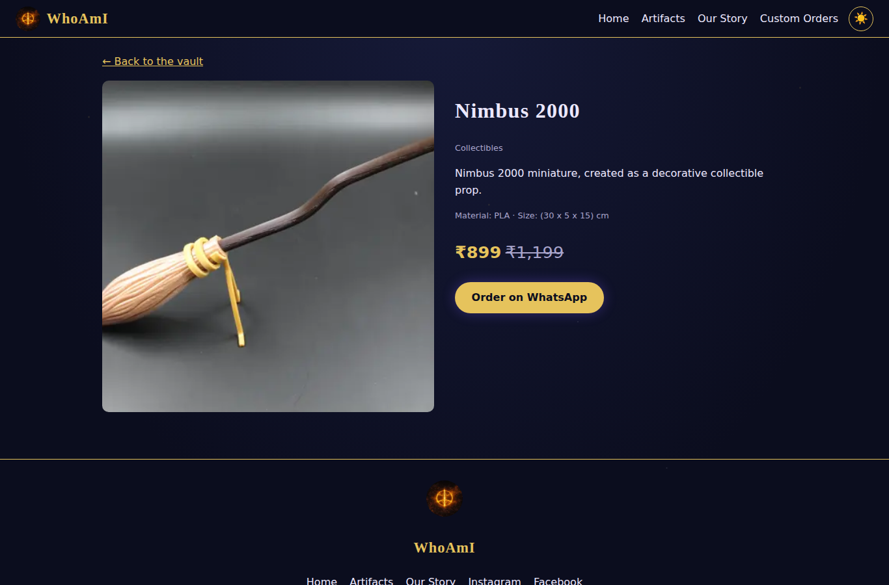
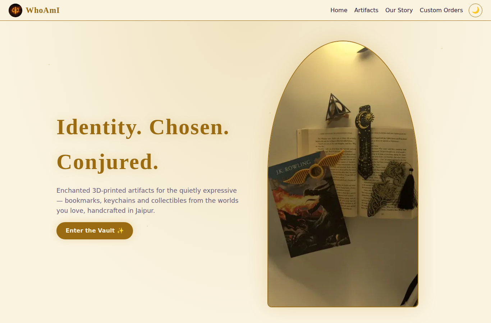

# WhoAmI Studios - Product Listing Website (Part 1)

Lab assignment: Full-Stack E-Commerce Application, Part 1.
Product catalogue for **WhoAmI Studios** (handcrafted 3D-printed bookmarks, keychains and collectibles, Jaipur). Product data and images come from the WhoAmI brand catalogue.

## Architecture

```
Browser (public/index.html, vanilla JS)  --fetch-->  Express REST API (server.js)  --SQL-->  SQLite (store.db)
```

- **Frontend** - one static page (header, nav, hero, product list with search + category filter, details view, footer, light/dark theme toggle). Hash routing: `#/`, `#/product/:id`.
- **Backend** - Express serves the frontend and the API. Products are only read through the API, never directly by the browser.
- **Database** - SQLite. `schema.sql` creates the `products` table and seeds 25 sample products; it runs automatically on server start.

## API

| Method | Endpoint | Description |
|---|---|---|
| GET | `/api/products?q=&category=` | List products; optional text search and category filter. `200` |
| GET | `/api/products/:id` | Single product. `200`, `400` (invalid id), `404` (not found) |

## Run locally

Prerequisites: Node.js 18+ and npm.

```bash
git clone https://github.com/IshitaAgarwal05/PL-LA9-Ecom-Website.git
cd whoami-store
npm install
npm start
```

Open http://localhost:3000. No configuration needed. To reset the database, delete `store.db` and restart.

## Screenshots

**Product listing (dark theme, with hero and footer)**


**Search**


**Product details view**


**Light theme (toggle at top right)**

